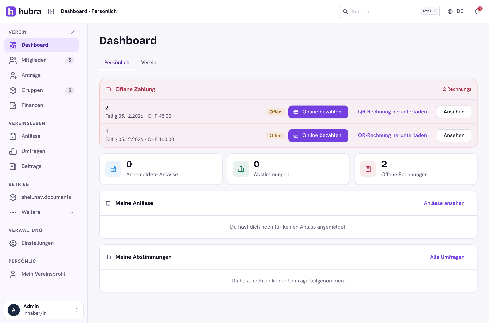
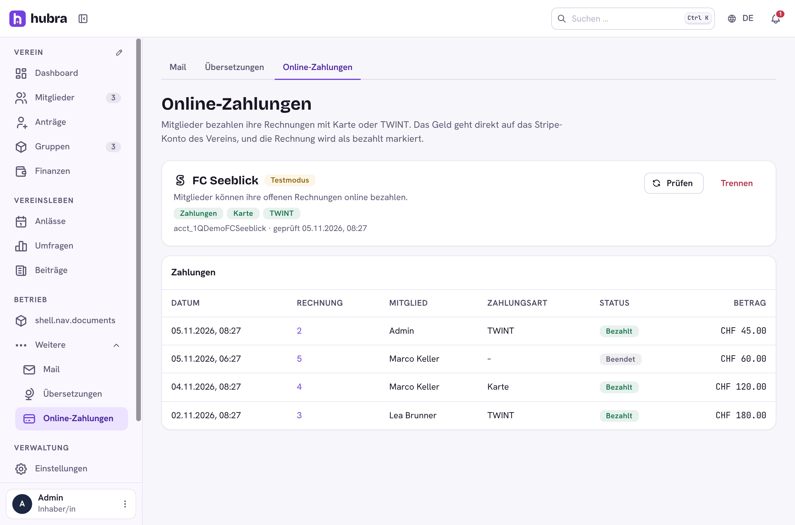
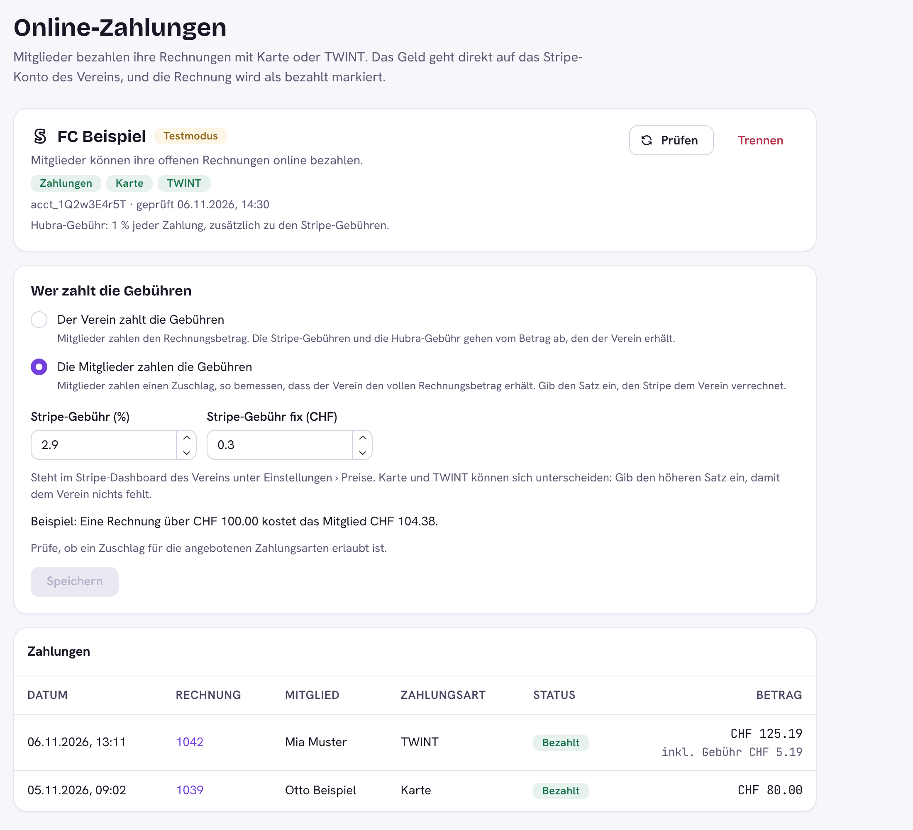

# Online payments (Hubra plugin)

Members pay their invoices online, by card or TWINT. Each club connects its
**own Stripe account** to the platform's (Stripe Connect, a Standard
account): the money goes straight to the club, Stripe takes its fees from
the club, and the invoice is marked paid by itself, which completes its
income transaction like a bank payment would.

**Plugin id** `payments` · **Package** `hubra_payments` · **Module** `payments` · **Needs** the `members` and `finance` modules, Hubra with the `invoice.actions` slot



## Set up

1. **Platform** (once, manage › Payments): the platform's Stripe secret key
   (`sk_test_…` for test mode, `sk_live_…` for real money), and optionally a
   Hubra fee in percent (Hubra's share of each payment; manage › All clubs ›
   club › Billing can set a club's own). Connect must be turned on in the platform's
   Stripe dashboard.
2. **Club** (Finanzen › Einstellungen › Online-Zahlungen; the payments list is under Finanzen › Buchungen; permission
   `payments.account.manage`): **Stripe verbinden** creates the club's
   Stripe account and opens Stripe's setup, where the club enters its details
   and bank account. Back in Hubra the page shows whether Stripe allows
   payments yet, and whether card and TWINT are active. TWINT is turned on in
   the club's own Stripe dashboard (Settings › Payment methods).
3. **Members** see **Online bezahlen** next to each of their open invoices
   (Dashboard › Persönlich, and the invoice page). Stripe Checkout offers the
   payment methods the club turned on.



## Who pays the fees

By default the member pays the invoice amount, and Stripe's fee and the
Hubra fee come off what the club receives. Under **Wer zahlt die Gebühren**
the club can pass them on instead: it enters the rate Stripe charges it
(percent plus a fixed amount per payment, from its Stripe dashboard), and
members pay a surcharge on top, sized so the club still receives the full
invoice amount:

    total = (invoice + fixed) / (1 − Stripe % − Hubra %), rounded up to the cent

Checkout shows the surcharge as its own line ("Gebühr für die Online-Zahlung"),
the pay button says a fee comes on top, and the club's list of payments shows
it. Card and TWINT can cost different amounts; the club enters the higher rate.
Check that a surcharge is allowed for the payment methods the club offers.



## How a payment is booked

Stripe can't send Connect webhooks to one club, so Hubra asks Stripe:

- when the member comes back from Checkout (`/app/payments/return`), and
- every ten minutes for checkouts still open (`hubra_payments.tasks.sync_open`).

A paid checkout marks the invoice paid only when the amount (invoice plus
any surcharge) and currency match. An open checkout is used again while it has more than ten minutes
left; if the invoice amount changed, the member gets a new one. Checkouts end
after 24 hours (Stripe's limit). Disconnecting Stripe ends open checkouts;
the Stripe account and its money stay the club's.

Refunds are made in the club's Stripe dashboard; mark the invoice open again
in Hubra if needed.

## API

`/api/v1/app/payments`: `GET /status`, `POST /connect`, `POST /refresh`,
`DELETE /connect`, `GET /checkouts`, `POST /invoices/<id>/checkout` (only
the member the invoice is for), `POST /checkouts/confirm`.

## Develop

Clone into `plugins/payments` of a Hubra checkout, then from `app/backend`:

```
pytest ../../plugins/payments          # Stripe is faked, no network
cd ../frontend && npm run build:plugin -- ../../plugins/payments
```

Releasing: bump `version` in `plugin.yaml`, merge, then tag the merged commit
on main and push the tag (`git switch main && git pull`, then
`git tag v<version> && git push origin v<version>`). The workflow tests and
signs the plugin, and after the signing approval publishes the GitHub release
`v<version>` with `payments-<version>.zip` attached. Releases are immutable:
fix a bad one with a new version.
